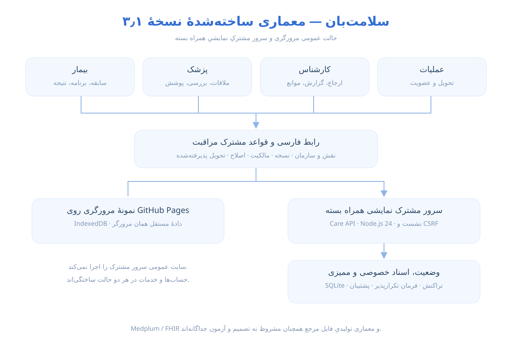
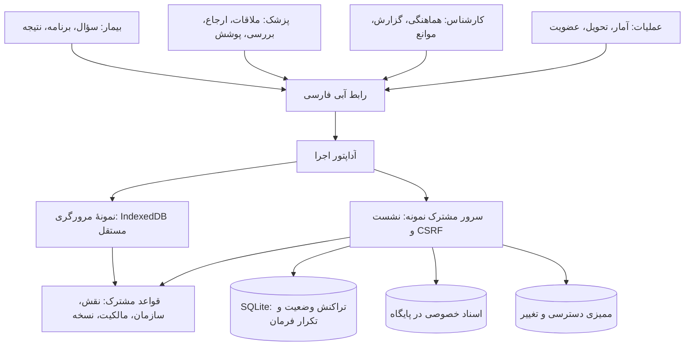

# معماری ساخته‌شدهٔ مسیر تازه

نسخهٔ `3.2.1-next.1` · این سند وضعیت پیاده‌سازی است؛ معماری پیشنهادی Medplum/FHIR در فایل‌های جلسه همچنان تصمیم مشروط و جداگانه است.



## یک منطق، دو حالت اجرا



`website/next/config.json` در بسته و سایت عمومی حالت `browser-demo` دارد. سرور مشترک هنگام پاسخ به همین مسیر، حالت `shared-demo` و مسیر هم‌مبدأ `/api/care` را اعلام می‌کند. اگر تنظیمات دریافت نشود، برنامه خطا و امکان تلاش دوباره می‌دهد؛ بی‌خبر از دادهٔ مشترک به دادهٔ محلی تغییر نمی‌کند.

## قواعد و داده‌ها

- `browser-auth.ts`: حساب‌ها و کدهای ساختگی مسیر تازه، با حفظ نشست‌های قبلی و بدون تغییر بستهٔ ورود نسخهٔ ۲٫۴٫۷.
- `model.ts`: سفر اولیه و برنامهٔ موجود؛ `care.ts`: ملاقات، ارجاع، نسخهٔ گزارش، بررسی، مسئولیت، پوشش، مانع و عضویت.
- `views.ts`: نمای مجاز هر نقش. پیش‌نویس و متن خصوصی ملاقات/بررسی به بیمار نمی‌روند. گزارش نامطمئن تا تطبیق نمایش داده نمی‌شود. کارشناس فقط دادهٔ لازم برای کار تخصیص‌یافته دارد.
- `files.ts`: نوع/امضای ابتدایی، اندازه و SHA-256. سرور نیز بایت‌ها را دوباره بررسی می‌کند؛ اعتماد به MIME ارسالی کافی نیست.
- `export-record.ts`: ZIP پروندهٔ خود بیمار، اصل فایل‌ها، JSON و نسخهٔ چاپی؛ متن خصوصی پزشک در آن نیست.
- مهلت‌ها تاریخ صریح‌اند؛ رابط موعد گذشته را نشان می‌دهد. آستانه یا اولویت فوریت پزشکی خودکار از داده‌ها استنتاج نمی‌شود.

جداول واقعی سرور: `state` برای وضعیت نسخه‌دار، `sessions` برای نشست‌های ساختگی با انقضا، `challenges` برای کد نمایشی، `documents` برای بایت اسناد خصوصی، `commands` برای تکرار امن درخواست و `audit` برای سابقهٔ محدود دسترسی/تغییر. در یک تراکنش، نسخه، ظرفیت مرتبط و قواعد بررسی، وضعیت، فایل و کلید فرمان ثبت می‌شوند. ارسال واقعی SMS یا کارگر خارجی در این نمونه وجود ندارد؛ شکست تحویل، کار بالینی را حذف نمی‌کند.

دادهٔ مرورگری قبلی حذف نمی‌شود. هشت نمونهٔ تازه فقط برای شماره‌هایی که قبلاً وجود ندارند اضافه می‌شوند؛ پرونده‌های ویرایش‌شده جایگزین نمی‌شوند. دو مسیر ریشهٔ ۲٫۴٫۷ و next همچنان مستقل‌اند.

## اجرای مشترک محلی

Node.js 24 یا جدیدتر لازم است؛ SQLite داخلی Node استفاده می‌شود.

در سورس:

```sh
cd source/site
npm ci
npm run build:next
npm run build:next:server
npm run start:next:server
```

در بستهٔ کامل، بدون نصب وابستگی برای سرورِ ازپیش‌ساخته‌شده:

```sh
node shared-demo-server/main.mjs
```

سپس `http://127.0.0.1:4210/next/` را باز کنید. دو مرورگر جدا یا یک پنجرهٔ عادی و ناشناس، با نقش‌های متفاوت، روی یک پرونده کار می‌کنند. سرور پیش‌فرض فقط به `127.0.0.1` گوش می‌دهد. حساب‌ها و کدها همچنان ساختگی‌اند و مسیر ورود سریع فعال است؛ این فرمان برای استقرار خدمت واقعی نیست.

تنظیم‌های اختیاری: `PORT`، `BIND_HOST`، `NEXT_DEMO_DB` برای فایل پایگاه، `NEXT_DEMO_WEBSITE` برای وب‌سایت ساخته‌شده، `NEXT_DEMO_ORIGIN` برای مبدأ صریح پشت پراکسی. فایل پایگاه را خارج از پوشهٔ عمومی نگه دارید. برای TLS، مبدأ درست و پراکسی مسئول لازم است؛ سرور داخلی TLS ارائه نمی‌کند.

## پشتیبان و بازیابی نمونه

```sh
node shared-demo-server/backup.mjs .next-data/care.sqlite /path/to/private/new-backup.sqlite
```

مسیر پشتیبان باید تازه باشد؛ فایل موجود بازنویسی نمی‌شود. پشتیبان شامل اسناد خصوصی و نشست‌های نمونه است و نباید در وب‌سایت یا ZIP تحویل قرار گیرد. برای آزمون بازیابی، سرور را متوقف و `NEXT_DEMO_DB` را به نسخهٔ پشتیبان تنظیم کنید. تست خودکار، بازگشت پرونده، مدرک و مسئولیت باز از پایگاه پشتیبان را بررسی می‌کند. این آزمون، برنامهٔ بازیابی تولیدی با RPO/RTO مصوب نیست.

## پیش از خدمت واقعی

احراز هویت و بازیابی واقعی، هویت حرفه‌ای، محدودسازی ورود، حفاظت و اسکن اسناد، سیاست نگهداری، ممیزی کنترل‌شده، میزبانی و پشتیبان داخلی، ظرفیت/ساعات پاسخ، مجوزها، قراردادها و پروتکل‌ها باید آماده و آزموده شوند. انتخاب Postgres یا Medplum/FHIR و دو پایگاه نیز نیازمند تصمیم و آزمون جداست. سرور نمونه از این موارد عبور نمی‌کند و به‌عنوان سرویس بالینی آماده معرفی نشده است.

## تغییرهای تجربهٔ نسخهٔ ۳٫۲

نمای اول به وضعیت، اقدام، کار تیم و نتیجه اختصاص دارد. سه سابقهٔ طولانی چنددوره‌ای، داده‌های نمودار با منبع و اصل مدارک PDF/PNG دارند. داده‌های موجود فقط در صورتی ارتقا می‌یابند که نمونهٔ دست‌نخوردهٔ ۳٫۱ باشند؛ هر ویرایش کاربر نسخه را افزایش می‌دهد و آن پرونده جایگزین نمی‌شود. اصل PDFهای موجود بایت‌به‌بایت حفظ شده است.

پیش‌نمایش `?preview=09000000003` یک نمای فقط‌خواندنی و موقت از دادهٔ ساختگی است: هیچ نشست، IndexedDB یا BroadcastChannel ایجاد نمی‌کند و فرمان تغییردهنده را نمی‌پذیرد. این رفتار حتی در کنار اجرای مشترک، فقط نمونهٔ عمومی آماده را نشان می‌دهد و فایل‌های بارگذاری‌شدهٔ کاربران را وارد پیش‌نمایش نمی‌کند.

مشخصات اختیاری در `profile` و درخواست‌های پشتیبانی با مسئول عملیات در `support` همان پرونده نگه‌داری می‌شوند. عملیات فقط متن درخواستی را می‌بیند که بیمار آگاهانه برای پشتیبانی ثبت کرده؛ محتوای خصوصی بالینی در نمای عملیات قرار نمی‌گیرد. پاسخ پشتیبانی به همان بیمار برمی‌گردد. درخواست حذف، حذف خودکار سوابق نیست.

بازبودن آزمون پنج مخاطب تازه و دستگاه فیزیکی در [وضعیت هدف](../NEXT-GOAL-fa.md) ثبت شده؛ هیچ ادعای آمادگی خدمت واقعی یا پذیرش این دو معیار وجود ندارد.
